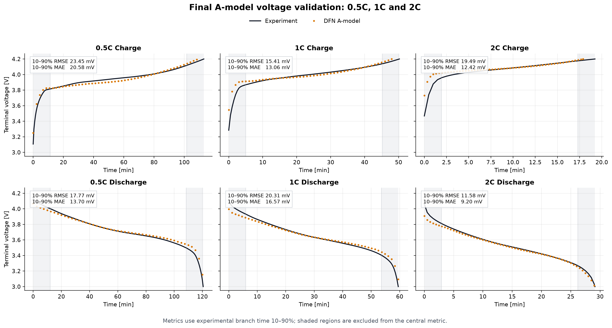
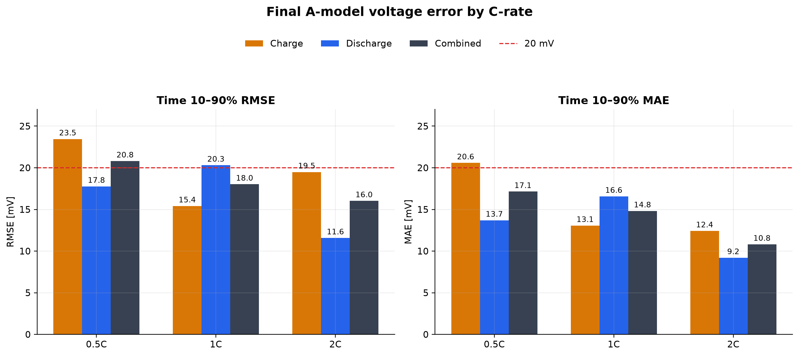

# 2026-10-23 최종 A모델

이 폴더는 후속 충전 프로토콜 최적화의 초기 DFN 모델로 사용할 **최종 A모델**을 고정한다. 2026-10-21까지 권고했던 ORegan2022 전해질 및 전압 fitting 조합은 최종 기준에서 제외하고 비교 이력으로만 보존한다.

## 최종 선정 조합

- 모델: PyBaMM DFN, isothermal
- 기반 parameter set: Ai2020
- OCP: **Ai2020 graphite 음극 OCP + 실측 양극 GITT 평균 OCP**
- 전해질: **단위 보정 Ai2020 electrolyte parameter set**
- Stoichiometry window: C/50 qOCV 기반 재최적화
- Geometry: teardown/SEM 기반 값
- 고체 확산계수: GITT 기반 `D_s,n`, `D_s,p`
- 반응속도: EIS–DRT 기반 `k_n=5.54×10^-7`, `k_p=4.37×10^-7`
- Bruggeman coefficient: Ai2020 값 `b_n=2.914`, `b_s=1.500`, `b_p=1.830`
- ORegan2022 전해질: 미적용
- 경험적 OCP hysteresis 보정: 미적용
- `k_n` 또는 `k_n+b_n` voltage fitting: 최종값에 미적용

`R_ct,n=30.6971 Ω cm²`, `R_ct,p=25.387 Ω cm²`는 DFN solver의 직접 입력이 아니다. EIS–DRT 측정 근거로부터 `k_n`, `k_p`를 산정할 때만 사용하며, 실제 PyBaMM 입력에서는 exchange-current density 함수를 해당 `k` 값으로 스케일링한다.

## 핵심 파라미터

| 구분 | 파라미터 | 최종값 | 근거·상태 |
|---|---|---:|---|
| 셀 | 기준 용량 | 2.356528 Ah | C/50 실험 |
| OCP | 음극 | Ai2020 graphite OCP | 문헌·고정 |
| OCP | 양극 | 실측 GITT 평균 OCP | 실측·고정 |
| Window | `x0 / x100` | 0.003803365 / 0.954167038 | C/50 qOCV fitting |
| Window | `y0 / y100` | 0.970716344 / 0.431646230 | C/50 qOCV fitting |
| Inventory | `c_s,max,n` | 25,184.17 mol m^-3 | 용량/window 일관성 계산 |
| Inventory | `c_s,max,p` | 49,143.14 mol m^-3 | 용량/window 일관성 계산 |
| Geometry | `L_n / L_p` | 76.5 / 68.0 µm | teardown |
| Geometry | `ε_s,n / ε_s,p` | 0.610 / 0.620 | 고정 |
| Geometry | `R_n / R_p` | 3.692 / 4.239 µm | SEM/ImageJ |
| Geometry | 총 겹침면적 | 0.0787236 m² | 45.4 mm × 51.0 mm × 34면 |
| Diffusion | `D_s,n` | 4.170774×10^-14 m² s^-1 | GITT |
| Diffusion | `D_s,p` | 6.888175×10^-14 m² s^-1 | GITT |
| Kinetics | `k_n` | 5.54×10^-7 | 음극 EIS–DRT 기반 |
| Kinetics | `k_p` | 4.37×10^-7 | 양극 EIS–DRT 기반 |
| Bruggeman | `b_n / b_s / b_p` | 2.914 / 1.500 / 1.830 | Ai2020 |
| Electrolyte | `D_e` | Ai2020 함수 ×10^-4 | 원 함수 단위 보정 |

전체 항목과 분류는 [`A_MODEL_FINAL_PARAMETER_SET.csv`](A_MODEL_FINAL_PARAMETER_SET.csv)에 있다. `c_s,max,n/p`는 직접 측정값이 아니라 선택 OCP/window, 실험 용량, 면적, 두께 및 활물질 분율을 일관되게 연결한 계산값이다.

## 시뮬레이션 조건

- 초기 상태: C/50 방전으로 3.0 V 도달 후 10분 휴지
- 연속 이력: 0.5C → 1C → 2C 충·방전
- 충전: 4.2 V까지 CC 후 C/20까지 CV
- 방전 cutoff: 3.0 V
- 주요 step 사이 휴지: 10분
- 평가 구간: 각 실험 branch 시간의 10–90%
- 목적함수: 전압 잔차만 사용하며 capacity error는 제외

## 0.5C·1C·2C 전압 검증

| C-rate | 충전 RMSE / MAE | 방전 RMSE / MAE | 충·방전 통합 RMSE / MAE |
|---:|---:|---:|---:|
| 0.5C | 23.45 / 20.58 mV | 17.77 / 13.70 mV | 20.81 / 17.14 mV |
| 1C | 15.41 / 13.06 mV | 20.31 / 16.57 mV | 18.03 / 14.82 mV |
| 2C | 19.49 / 12.42 mV | 11.58 / 9.20 mV | 16.03 / 10.81 mV |
| 전체 | 19.73 / 15.36 mV | 16.95 / 13.16 mV | **18.39 / 14.26 mV** |

“전압 오차 20 mV 이하”는 **실험 branch 시간 10–90%의 전체 통합 RMSE 18.39 mV**를 의미한다. 시작·종료 과도와 cutoff 차이를 포함한 전체 원시구간은 RMSE 41.02 mV, MAE 23.97 mV이므로 같은 표현을 적용하지 않는다. 조건별 원시 수치는 [`A_MODEL_VOLTAGE_METRICS.csv`](A_MODEL_VOLTAGE_METRICS.csv)에 있다.

## 선정 이유

1. 실험으로 확보한 OCP, window, geometry, `D_s`, EIS–DRT 기반 kinetics를 우선하고 경험적 hysteresis를 제거했다.
2. Ai2020 전해질을 유지해 대상 셀 논문의 GC–MS 조성과 모델 출처를 보존했다. ORegan2022 전해질로 바꿔도 SoC별 음극 전위 개선이 뚜렷하지 않았다.
3. `k_n` 단독 voltage fitting 결과 `5.53006×10^-7`은 EIS 기반 `5.54×10^-7`과 0.18% 차이에 불과했다.
4. `k_n+b_n` 동시 fitting은 충전 일부를 개선했지만 방전 통합 오차를 악화시키고 두 파라미터의 상호보상 가능성이 있어 채택하지 않았다.

## 파일

- [`Ai2020_DFN_Chapter1_2_Amodel_FINAL.ipynb`](Ai2020_DFN_Chapter1_2_Amodel_FINAL.ipynb): Chapter 1–2 흐름, 최종 파라미터와 검증 결과를 담은 열람·재현용 노트북
- [`A_MODEL_FINAL_PARAMETER_SET.csv`](A_MODEL_FINAL_PARAMETER_SET.csv): 전체 파라미터, 근거와 분류
- [`A_MODEL_VOLTAGE_METRICS.csv`](A_MODEL_VOLTAGE_METRICS.csv): C-rate·방향별 시간 10–90% 및 전체구간 오차
- [`A_MODEL_voltage_0p5C_1C_2C.png`](A_MODEL_voltage_0p5C_1C_2C.png): 충·방전 전압 비교
- [`A_MODEL_voltage_error_by_Crate.png`](A_MODEL_voltage_error_by_Crate.png): RMSE/MAE 요약

노트북의 기본 `RUN_FULL_SIMULATION=False`는 저장된 결과를 빠르게 검토하기 위한 설정이다. 전체 DFN 재실행에는 `work/stage2_inputs/`의 원본 데이터와 Python 3.12/PyBaMM 환경이 필요하다.

## 적용 한계

- 본 검증은 0.5C·1C·2C terminal voltage에 대한 것이다.
- 음극 전위는 직접 측정 검증값이 아니라 DFN 내부 예측량이므로 충전 프로토콜 제약조건으로 사용할 때 파라미터 민감도와 안전 여유를 함께 적용해야 한다.
- HPPC 검증 결과는 사용자의 결정에 따라 본 최종 모델 패키지에서 제외했다.
