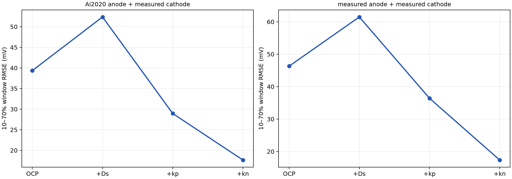
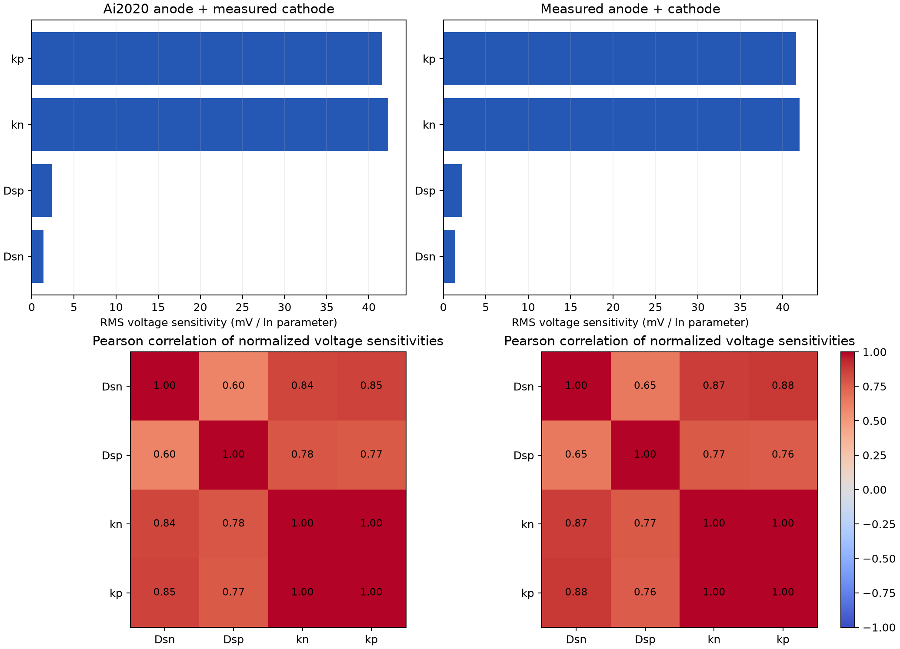

# Ai2020 DFN 간결본 이어가기: 2단계 결과

## 범위와 비교 기준

1단계의 공통 기하·용량 일치 계산을 이어받아 **① Ai2020 음극 OCP + 측정 양극 GITT OCP**와 **② 측정 저율 음극 OCP + 측정 양극 GITT OCP**를 비교했다. 각 조합의 stoichiometry window와 그로부터 구한 `c_s,max`는 별도로 적용했다. 원본 Excel에서 추출한 0.5C, 1C, 2C 충전·방전 전압 여섯 조건을 같은 방식으로 비교했다. 이번 2단계는 실험 기반 파라미터를 **순서대로 대입한 검증**이며, 전압 잔차를 최소화하는 재피팅 결과는 아니다.

| OCP 조합 | 음극 window (x0→x100) | 양극 window (y0→y100) | `c_s,max,n` | `c_s,max,p` |
|---|---:|---:|---:|---:|
| Ai2020 음극 + 측정 양극 | 0.003803→0.954167 | 0.970716→0.431646 | 25,184 mol m⁻³ | 49,143 mol m⁻³ |
| 측정 음극 + 측정 양극 | 0.002150→0.739784 | 0.976291→0.448293 | 32,447 mol m⁻³ | 50,174 mol m⁻³ |

## 2단계 1차: 실험값 대입 (Ds → kp → kn)

GITT에서 `Dsn = 4.17077×10⁻¹⁴`, `Dsp = 6.88818×10⁻¹⁴ m²/s`를 사용했다. 입자반경은 `rn = 3.692 µm`, `rp = 4.239 µm`이다. 양극 EIS–DRT의 `Rct,p = 25.387 Ω cm²`, 음극 N3+N4의 **local-minimum 적분**으로 구한 `Rct,n = 27.000934 Ω cm²`를 사용했다. 음극의 예전 peak 단순 합산값 `30.6971 Ω cm²`는 쓰지 않았다. 각각 `j0,p = 0.339186`, `j0,n = 0.250945 A/m²`에 해당한다. 음극 DRT 기반 값은 초기값 근거이며 독립적 최종 검증으로 취급하지 않는다.

`k = j0 / [c_s,max √(c_e z50(1−z50))]`, `c_e = 1000 mol/m³`를 사용했다. `z50`은 **각 OCP window의 full-cell 50% SOC**이다. 따라서 슬라이드의 반충전 상태 가정 `z = 0.5`로 표시된 `k`와 숫자가 다르다. 단위는 `A m⁻² (m³ mol⁻¹)^1.5`이다.

| OCP 조합 | `kn` | `kp` |
|---|---:|---:|
| Ai2020 음극 + 측정 양극 | 6.308×10⁻⁷ | 4.768×10⁻⁷ |
| 측정 음극 + 측정 양극 | 5.063×10⁻⁷ | 4.722×10⁻⁷ |

6개 조건의 RMSE를 제곱평균으로 합산했다. 중앙 구간은 각 조건의 정격용량 기준 **10–70% 구간**이다. 전체 구간 RMSE는 종료 시점 차이에 민감하므로 두 수치를 함께 제시한다.

| OCP 조합 | 적용 단계 | 전체 RMSE (mV) | 10–70% RMSE (mV) |
|---|---|---:|---:|
| Ai2020 음극 + 측정 양극 | OCP/window만 | 46.69 | 39.36 |
| 〃 | + GITT Ds | 56.47 | 52.36 |
| 〃 | + 양극 kp | 40.15 | 28.94 |
| 〃 | + 음극 kn 초기값 | **37.11** | **17.66** |
| 측정 음극 + 측정 양극 | OCP/window만 | 51.62 | 46.31 |
| 〃 | + GITT Ds | 65.86 | 61.47 |
| 〃 | + 양극 kp | 45.80 | 36.41 |
| 〃 | + 음극 kn 초기값 | **36.95** | **17.37** |

`Ds`만 교체한 단계의 RMSE는 양쪽 모두 증가했다. 이후 `kp`, `kn`을 더하면 감소한다. 이는 고정된 다른 파라미터와의 보상 관계가 있음을 시사하며, **GITT 값 자체의 오류를 증명하지 않는다**. 최종 두 OCP의 전체 오차 차이는 `0.16 mV`, 중앙 구간 차이는 `0.29 mV`에 불과하므로 현재 조건으로 우열을 확정하기 어렵다. 1단계 OCP-only 일부 방전/충전 끝에서는 측정 OCP 보간 범위를 넘는 PyBaMM 경고가 있었으므로 끝단 해석은 특히 보수적으로 해야 한다.

### 추가 확인: k를 고정하면 nominal Ds와 GITT Ds 중 어느 쪽이 나은가?

위의 `OCP_only → +Ds` 비교는 **Ai2020 nominal k 상태**에서 두 Ds를 한꺼번에 바꾼 것이다. 같은 실험 기반 `kp`, `kn`을 고정해 Ds만 다시 비교하면 결론이 뒤집힌다. Ai2020 nominal `Dsn = 3.900×10⁻¹⁴`, `Dsp = 5.387×10⁻¹⁵ m²/s`이며, GITT `Dsn`은 약 7% 높고 `Dsp`는 약 12.8배 높다.

| OCP 조합 | 고정된 k에서 Ds 조합 | 전체 RMSE (mV) | 10–70% RMSE (mV) |
|---|---|---:|---:|
| Ai2020 음극 + 측정 양극 | nominal n+p | 46.14 | 28.52 |
| 〃 | GITT n만 | 45.94 | 28.49 |
| 〃 | GITT p만 | 37.26 | **17.64** |
| 〃 | GITT n+p | **37.11** | 17.66 |
| 측정 음극 + 측정 양극 | nominal n+p | 42.84 | 23.54 |
| 〃 | GITT n만 | 42.62 | 23.50 |
| 〃 | GITT p만 | 37.07 | **17.34** |
| 〃 | GITT n+p | **36.95** | 17.37 |

즉, **nominal Ds가 일반적으로 더 낫다는 결론은 성립하지 않는다**. 이 검증 범위에서는 실험 k를 적용했을 때 GITT 양극 `Dsp`가 전압 오차를 크게 줄인다. `Dsn`의 영향은 작고, 중앙 구간에서는 GITT `Dsn`까지 추가한 경우가 GITT 양극만 적용한 경우보다 약 `0.02–0.03 mV` 높다. 작은 차이를 근거로 최적 `Dsn`을 판단할 수는 없다. 근거 데이터는 `Stage2_Ds_nominal_vs_GITT_fixed_k.csv`에 있다.

## 2단계 2차: COBRAPRO 방식의 국소 민감도·식별도

첨부된 *Sensitivity/correlation analysis* 자료 7–14쪽과 *COBRAPRO tutorial* 35–38쪽의 절차를 현재 **PyBaMM DFN** 모델에 적용했다. COBRAPRO 소프트웨어 자체를 실행한 결과는 아니다. 최종 실험값 대입 상태에서 `Dsn`, `Dsp`, `kn`, `kp` 각각을 `×1.05`와 `÷1.05`로 흔들어 중앙차분을 구했다. 여섯 CC 조건의 종료 전 공통 10–70% 용량시간 범위에서 각 80점, 총 480개의 전압 관측을 사용했다. 정규화 민감도는 `Sθ = (∂V/∂lnθ)/V0`; 식별도는 민감도 열의 Pearson 상관과 그리디 상관 임계값 `β`로 평가했다. **실측 전극 SOC는 없으므로 전압만 사용한 적용**이다. 자료의 HPPC 예시에서 선정된 파라미터 집합을 이 셀의 결과로 전용하지 않았다.

| OCP 조합 | 파라미터 | RMS 민감도 (mV / ln θ) | 5% 변화에 대한 전압 RMS (mV) |
|---|---|---:|---:|
| Ai2020 음극 + 측정 양극 | kn / kp | 42.28 / 41.55 | 2.063 / 2.027 |
| 〃 | Dsp / Dsn | 2.36 / 1.37 | 0.115 / 0.067 |
| 측정 음극 + 측정 양극 | kn / kp | 42.00 / 41.56 | 2.049 / 2.028 |
| 〃 | Dsp / Dsn | 2.21 / 1.41 | 0.108 / 0.069 |

`kn`–`kp` 정규화 전압 민감도 상관계수는 두 OCP에서 각각 **0.99850**, **0.99937**이다. 열 크기를 1로 맞춘 민감도 행렬의 조건수는 각각 **34.0**, **38.7**이다. 상관 임계값 그리디 선택은 두 OCP 모두 `β = 0.8`에서 `{kn, Dsp}`, `β = 0.95` 또는 `0.99`에서 `{kn, Dsp, Dsn}`이다. `kp`는 `kn`과의 강한 상관 때문에 제외된다. 이 선택은 **상관 기준의 수학적 후보 집합**이지, 전압만으로 세 파라미터를 신뢰성 있게 피팅할 수 있다는 뜻은 아니다.

특히 `Dsp`, `Dsn`을 5% 바꿔도 전압 변화가 약 `0.07–0.12 mV RMS`로, 최종 중앙 구간 모델 RMSE 약 `17 mV`보다 훨씬 작다. 따라서 이번 0.5–2C CC 전압만으로 두 `Ds`를 실용적으로 식별했다고 주장할 수 없다. 또한 `kn`과 `kp`의 응답이 거의 같으므로 둘을 동시에 자유롭게 피팅하면 분리해 추정하기 어렵다. **현 단계 제안:** 측정 `Ds`와 양극 `kp`를 고정하고 음극 `kn` 한 개를 우선 피팅 대상으로 두되, 최종 검증에는 독립 실험 또는 HPPC·전극별 관측값을 추가한다. 이 결론은 네 후보 파라미터와 여섯 CC 조건에 한정된다.

## 재현 파일

- `261021_Ai2020_간결본_1-2단계_두OCP.ipynb`: 1단계 간결본을 유지하고 2단계 계산 코드를 추가한 노트북. 원본 입력 Excel 6개와 DRT workbook을 노트북 실행 폴더에 두고 위에서부터 실행한다. Stage 2 전체 실행은 로컬 PyBaMM 26.8.0.0에서 약 4분이었다. 원본 노트북의 명시 버전은 26.7.1.0이다.
- `Stage2_two_OCP_parameters.csv`: OCP별 window, c_s,max, Ds, Rct, j0, k.
- `Stage2_two_OCP_phase_summary.csv`, `Stage2_two_OCP_branch_metrics.csv`: 순차 대입 결과.
- `Stage2_Ds_nominal_vs_GITT_fixed_k.csv`: k 고정 후 Ds를 음극/양극별로 교체한 추가 검증.
- `Stage2_two_OCP_sensitivity.csv`, `Stage2_two_OCP_condition_sensitivity.csv`: 전체·조건별 민감도.
- `Stage2_Ai2020_anode__measured_cathode_Pearson_correlation.csv`, `Stage2_measured_anode__measured_cathode_Pearson_correlation.csv`, `Stage2_two_OCP_identifiability.json`: 식별도 근거.

계산 실행은 통합 Excel의 `CATHODE_GITT` 휴지 종료점 표를 이용해 대용량 원기록의 재파싱 시간을 줄였다. 얻어진 OCP window와 `c_s,max`는 기존 1단계 노트북 수치와 일치한다. 노트북을 처음부터 재실행하면 원본 GITT 파일을 읽는다.
