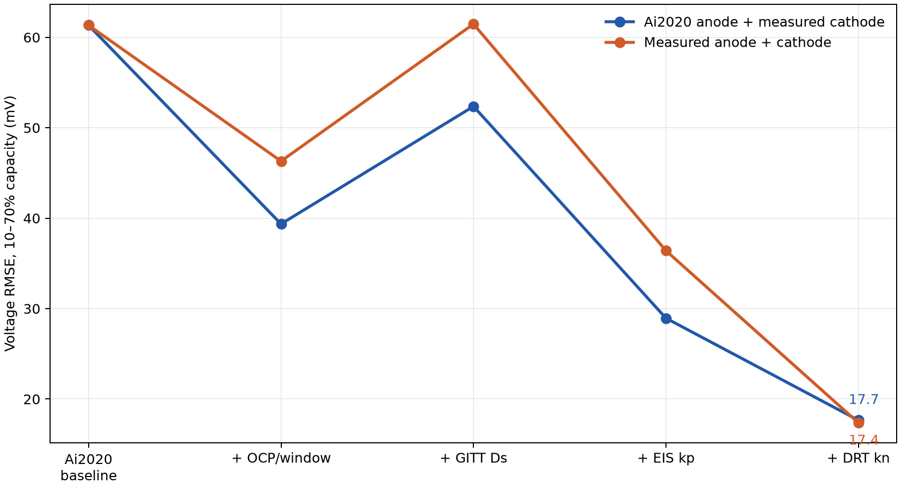
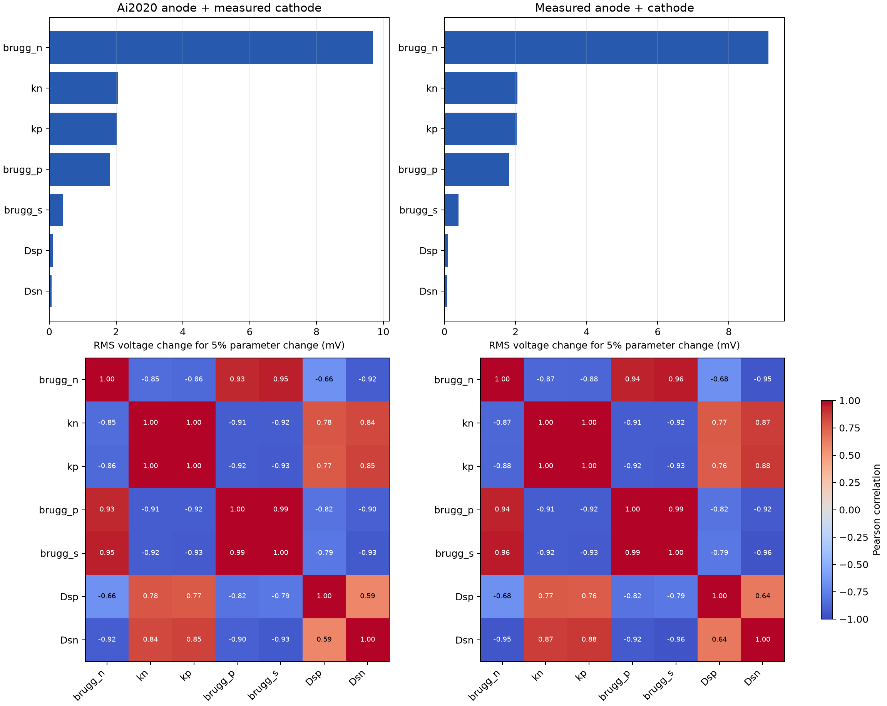

# 실험값 전체 반영 효과와 7개 파라미터 민감도·식별도

## 비교 설계

같은 0.5C·1C·2C 충방전 여섯 조건에서 공통 구조 보정을 끝낸 Ai2020 기준 모델과 실험값 반영 모델을 비교했다. **공통 기준**은 측정 입자반경·셀 면적과 전해질 확산도 단위 보정을 이미 반영한 상태에서 Ai2020 OCP/window, nominal Ds와 kinetics를 사용한다. 따라서 아래 개선율은 순수 미보정 Ai2020 대비가 아니라 **공통 구조가 같은 기준** 대비다. 최종 모델은 측정 양극 GITT OCP, 별도 비교한 두 음극 OCP, 각각 재선정한 window/c_s,max, GITT Ds, EIS 양극 kp, 음극 local-minimum DRT 기반 kn 초기값을 적용했다. **Bruggeman 계수는 변경하지 않고** 아래 민감도 후보에 포함했다.

## 실험값 반영 전후

| 모델 | 전체 RMSE | 10–70% RMSE | 종료 용량오차 RMS |
|---|---:|---:|---:|
| 공통 구조 보정 + Ai2020 OCP/nominal Ds·k 기준 | 59.48 mV | 61.34 mV | 2.15% |
| Ai2020 음극 + 측정 양극, 실험 Ds·k | 37.11 mV | 17.66 mV | 2.34% |
| 측정 음극 + 측정 양극, 실험 Ds·k | **36.95 mV** | **17.37 mV** | **0.76%** |

중앙 전압 RMSE는 각각 **71.2%, 71.7% 감소**, 전체 RMSE는 각각 **37.6%, 37.9% 감소**했다. 종료 용량오차는 측정 음극 조합에서 개선되지만 Ai2020 음극 조합에서는 기준보다 약간 증가한다. 그러므로 **모든 지표가 동시에 개선된 것**은 아니다. 최종 두 OCP의 전압 차이는 작다.

순차 반영 시에는 OCP/window만 → GITT Ds → 양극 kp → 음극 kn 순으로 비교했다. 기존 k를 둔 상태에서 GITT Ds만 넣으면 전압 RMSE가 증가하지만, 최종 실험 k를 고정한 재비교에서는 **GITT Ds 조합이 nominal Ds 조합보다 오차가 낮다**. 특히 양극 Dsp의 영향이 크다. 상세 값은 `Stage2_two_OCP_phase_summary.csv`, `Stage2_Ds_nominal_vs_GITT_fixed_k.csv`에 있다.

## COBRAPRO 자료 방식의 7개 파라미터 분석

첨부 *Sensitivity/correlation analysis* 7–14쪽과 *COBRAPRO tutorial* 35–38쪽의 **정규화 국소 민감도와 Pearson 상관 방법**을 PyBaMM DFN에 적용했다. COBRAPRO 소프트웨어 자체를 실행한 결과는 아니다. 최종 상태에서 각 파라미터를 `×1.05`, `÷1.05`로 교란하여 중앙차분했고, 6개 CC 조건의 종료 전 10–70% 용량시간 구간에서 80점씩 총 480개 전압 관측을 사용했다. `Sθ = (∂V/∂ln θ)/V0`이다. 전극별 SOC 측정값이 없어 전압만 분석했다.

후보 7개는 `Dsn`, `Dsp`, `kn`, `kp`, 전해질 유효수송의 `brugg_n`, `brugg_s`, `brugg_p`다. 마지막 세 값은 현재 Ai2020 기준인 **2.914, 1.500, 1.830**으로 두었다. `(electrode)` 고상 Bruggeman 항은 포함하지 않았다.

모든 후보를 계수값 기준 ±5%로 교란했으므로 아래 순위는 **해당 계수의 상대 변화**에 대한 결과다. Bruggeman 지수 5% 변화는 유효수송계수 `ε^b`의 5% 변화와 같지 않다.

| 후보 | 5% 변화 시 전압 RMS: Ai2020 음극 | 5% 변화 시 전압 RMS: 측정 음극 |
|---|---:|---:|
| brugg_n | **9.69 mV** | **9.11 mV** |
| kn | 2.06 mV | 2.05 mV |
| kp | 2.03 mV | 2.03 mV |
| brugg_p | 1.82 mV | 1.81 mV |
| brugg_s | 0.40 mV | 0.40 mV |
| Dsp | 0.114 mV | 0.107 mV |
| Dsn | 0.067 mV | 0.069 mV |

민감도는 `brugg_n`이 가장 크다. 그러나 Pearson 상관은 `kn`–`kp`가 **0.9985 / 0.9994**, `brugg_s`–`brugg_p`가 **0.9928 / 0.9924**, `brugg_n`–`brugg_s`가 **0.9460 / 0.9570**이다(순서: Ai2020 음극 / 측정 음극). 또한 `brugg_n`과 `Dsn`도 **−0.917 / −0.946**으로 강하게 겹친다. 크기를 1로 맞춘 7열 민감도 행렬의 조건수는 **60.4 / 69.5**다. 이는 현재 조건에서 7개를 한꺼번에 피팅하면 파라미터 사이 보상이 크다는 신호다.

COBRAPRO 자료의 민감도 순위→상관 임계값 그리디 선택을 적용하면 두 OCP 모두 `β=0.8`에서는 `{brugg_n, Dsp}`, `β=0.95` 또는 `0.99`에서는 `{brugg_n, kn, brugg_p, Dsp, Dsn}`이다. 이 결과는 **상관 기준 후보 집합**이지 5개 모두의 실용적 식별을 보장하지 않는다. 특히 Ds의 5% 전압 신호는 0.07–0.11 mV로 현재 모델 잔차 약 17 mV보다 훨씬 작다.

**실행 판단:** 측정 Ds와 양극 kp는 우선 고정하고, 전압 기준 피팅 후보로 `brugg_n`과 `kn`을 검토할 수 있다. 두 값도 상관이 `−0.849 / −0.872`이므로 독립 식별이 확정된 것은 아니다. `brugg_s`·`brugg_p`는 서로, `kn`·`kp`는 서로 강하게 겹친다. HPPC 또는 전극별 관측을 추가하면 이 판단을 다시 해야 한다. 이번 분석은 국소·전압 전용이며 기준 주변 ±5%에 한정된다. 측정 음극 OCP 일부 종단에서는 보간 범위 초과 경고가 있어 끝단 해석에 주의해야 한다.

## 계산 파일

- `Stage2_full_experimental_summary.csv`, `Stage2_full_experimental_branch_comparison.csv`: 기준과 최종 모델의 전체/조건별 오차.
- `Stage2_seven_parameter_sensitivity.csv`, `Stage2_seven_parameter_condition_sensitivity.csv`: 7개 후보의 전체/조건별 민감도.
- `Stage2_Ai2020_anode__measured_cathode_seven_parameter_Pearson.csv`, `Stage2_measured_anode__measured_cathode_seven_parameter_Pearson.csv`, `Stage2_seven_parameter_identifiability.json`: 상관 및 그리디 선택.
- `261021_Ai2020_간결본_1-2단계_두OCP.ipynb`: 앞선 간결본과 2단계에 이번 7개 후보 계산 셀을 추가했다. 원본 Excel 입력을 작업 폴더에 두고 순서대로 실행한다.
