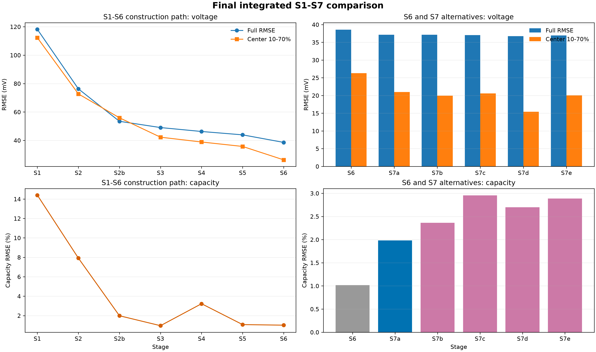
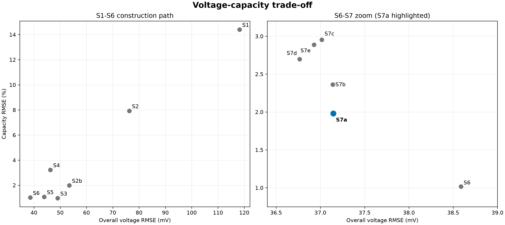
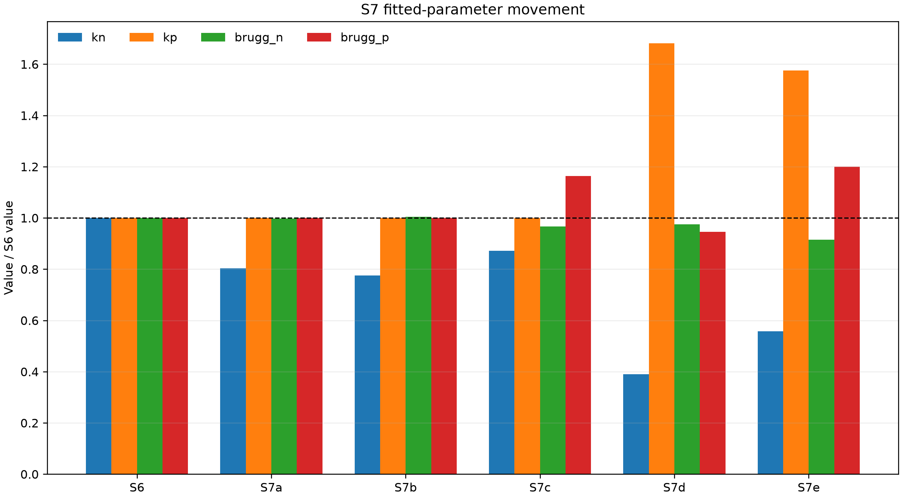

# DFN 모델링 최종 결과

## 1. 분석 목적과 범위

본 분석의 목적은 Ai2020 DFN을 출발점으로 실험 기반 파라미터와 전해질 수송 특성을 단계적으로 반영하고, 0.5C·1C·2C 충·방전 전압을 재현하는 실용적 DFN 기준모델을 선정하는 것이다.

- 대상 데이터: Cell 6-6 July BOL 0.5C·1C·2C 충·방전
- September 데이터: 본 최종 비교에서 제외
- 초기화: 각 실험 곡선의 rest-end 전압에서 독립 초기화
- 전압 평가: 실험과 모델의 시간–전압 곡선
- 중앙 평가구간: full-cell 기준 10–70% 용량구간
- S7 목적함수: 6개 곡선의 고정 시간격자 전압 RMSE 및 조기 cutoff 페널티
- 용량오차와 음극전위: fitting 목적함수에 포함하지 않고 사후 검증지표로 평가

## 2. 단계 정의

| 단계 | 반영 내용 |
|---|---|
| S1 | PyBaMM Ai2020 원형, nominal OCP 및 published window |
| S2 | S1에서 Ai2020 전해질 확산계수 단위 보정 |
| S2b | Ai2020 OCP를 유지하고 selected stoichiometry window와 capacity-consistent inventory 반영 |
| S3 | S2b와 동일한 window에서 selected OCP 반영 |
| S4 | 실측 입자반경 `Rn=3.7542 μm`, `Rp=4.2387 μm` 반영 |
| S5 | `kp`, `Dsn`, `Dsp` 실험 anchor 반영 |
| S6 | ORegan2022 전해질 수송식과 `brugg_n=2.5` 적용한 무피팅 기준모델 |
| S7a | `kn + brugg_n` 전압 fitting |
| S7b | `Dsn + kn + brugg_n` 전압 fitting |
| S7c | `kn + brugg_n + brugg_p` 전압 fitting |
| S7d | `kn + kp + brugg_n + brugg_p` 전압 fitting; 혼합 시작점 |
| S7e | S7d와 동일하나 `kn=kp=Ai2020` 시작점 |

기존 S6/S7a의 kinetics 시작 기준은 `kn=Ai2020`, `kp=양극 EIS`의 혼합 기준이다. 음극 EIS v2 값은 Ai2020 `kn`과 수치상 거의 같다.

## 3. 최종 통합 결과

| 단계 | 전체 전압 RMSE | 중앙 10–70% RMSE | 전체 MAE | 용량 RMSE | 최대 용량 오차 |
|---|---:|---:|---:|---:|---:|
| S1 | 118.20 mV | 112.31 mV | 105.14 mV | 14.40% | 444.4 mAh |
| S2 | 76.28 mV | 72.72 mV | 63.85 mV | 7.92% | 214.1 mAh |
| S2b | 53.44 mV | 55.92 mV | 42.44 mV | 1.99% | 58.9 mAh |
| S3 | 49.03 mV | 42.25 mV | 41.14 mV | 0.96% | 35.9 mAh |
| S4 | 46.27 mV | 38.87 mV | 38.25 mV | 3.22% | 100.0 mAh |
| S5 | 43.90 mV | 35.74 mV | 35.61 mV | 1.08% | 30.9 mAh |
| S6 | 38.59 mV | 26.30 mV | 27.68 mV | **1.02%** | **29.8 mAh** |
| **S7a** | 37.15 mV | 20.97 mV | 24.38 mV | 1.98% | 55.1 mAh |
| S7b | 37.14 mV | 19.94 mV | 24.28 mV | 2.36% | 68.4 mAh |
| S7c | 37.02 mV | 20.59 mV | 24.10 mV | 2.95% | 96.9 mAh |
| S7d | **36.77 mV** | **15.43 mV** | **22.56 mV** | 2.70% | 79.0 mAh |
| S7e | 36.93 mV | 20.06 mV | 24.48 mV | 2.89% | 91.4 mAh |

## 4. S7 파라미터 결과

| 단계 | Fitting 변수 | `Dsn` (m²/s) | `kn` | `kp` | `brugg_n` | `brugg_p` |
|---|---|---:|---:|---:|---:|---:|
| S6 | 없음 | 4.1708e-14 | 9.6485e-7 | 5.8995e-7 | 2.5000 | 1.8300 |
| **S7a** | `kn+brugg_n` | 4.1708e-14 | 7.7465e-7 | 5.8995e-7 | 2.4949 | 1.8300 |
| S7b | `Dsn+kn+brugg_n` | 4.0970e-14 | 7.4824e-7 | 5.8995e-7 | 2.5109 | 1.8300 |
| S7c | `kn+brugg_n+brugg_p` | 4.1708e-14 | 8.4068e-7 | 5.8995e-7 | 2.4170 | 2.1298 |
| S7d | `kn+kp+brugg_n+brugg_p` | 4.1708e-14 | 3.7653e-7 | 9.9239e-7 | 2.4363 | 1.7315 |
| S7e | 동일 4개, Ai/Ai 시작 | 4.1708e-14 | 5.3809e-7 | 9.2908e-7 | 2.2868 | 2.1949 |

`Dsp=6.8882e-14 m²/s`, `brugg_s=1.5`는 S6–S7 전체에서 고정했다.

## 5. 민감도와 식별도

현재 S6에서 동일한 ±5% 물리효과로 평가한 상대 전압 민감도는 다음과 같다.

| 순위 | 파라미터 | 상대 민감도 | 판단 |
|---:|---|---:|---|
| 1 | `brugg_n` | 1.000 | 높음 |
| 2 | `kp` | 0.448 | 높음 |
| 3 | `kn` | 0.434 | 높음 |
| 4 | `brugg_p` | 0.352 | 중간 |
| 5 | `brugg_s` | 0.136 | 낮음 |
| 6 | `Dsn` | 0.073 | GITT 값 고정 권장 |
| 7 | `Dsp` | 0.028 | GITT 값 고정 권장 |

- `kn-kp` sensitivity cosine: **0.991**. 두 kinetics를 단자전압만으로 독립 식별하기 어렵다.
- `brugg_p-brugg_s` cosine: **0.966**. 두 수송지수를 동시에 fitting하기 어렵다.
- S7a `kn+brugg_n` condition number: **2.29**.
- S7d 네 변수는 초기값과 seed에 따라 크게 다른 `kn/kp` 조합을 만들었다.

## 6. S7a C-rate별 검증

용량오차 부호는 `모델−실험`이다.

| 조건 | 전체 전압 RMSE | 중앙 RMSE | 용량 오차 |
|---|---:|---:|---:|
| 0.5C 충전 | 35.83 mV | 36.94 mV | −2.06% / −44.3 mAh |
| 0.5C 방전 | 35.58 mV | 16.71 mV | +0.44% / +10.1 mAh |
| 1C 충전 | 41.87 mV | 24.79 mV | −2.03% / −38.7 mAh |
| 1C 방전 | 36.27 mV | 16.46 mV | +0.88% / +19.8 mAh |
| 2C 충전 | 46.93 mV | 9.57 mV | −3.77% / −55.1 mAh |
| 2C 방전 | 21.39 mV | 4.05 mV | +0.06% / +1.3 mAh |

S7a 충전 최소 음극전위 예측은 0.5C `29.6 mV`, 1C `−12.8 mV`, 2C `−60.2 mV`이다. 이는 모델 경향성 평가값이며 절대 정확도는 3전극 실험 등으로 추가 검증해야 한다.

## 7. 최종 선정

### 최종 실용 DFN 모델: S7a

선정 근거는 다음과 같다.

1. S6 대비 전체 전압 RMSE가 38.59→37.15 mV로 감소했다.
2. 중앙 10–70% RMSE가 26.30→20.97 mV로 약 20% 개선됐다.
3. 저민감도 `Dsn`을 GITT 값으로 보존한다.
4. `brugg_n`은 2.5000→2.4949로 문헌값 2.5를 사실상 유지한다.
5. 실질적으로 식별 가능한 `kn`만 약 19.7% 보정한 해석 가능한 모델이다.
6. S7b는 추가 자유도 대비 개선이 거의 없고, S7c는 용량오차가 증가한다.
7. S7d/S7e는 전압 수치는 일부 개선되지만 `kn-kp` 비식별성과 초기값 의존성이 확인됐다.

S6는 무피팅 물리 기준모델로 유지하고, S7a를 충전 프로토콜 비교용 전압 보정모델로 사용한다.

## 8. 적용 범위와 한계

- 본 모델은 3단·5단·연속제어 충전 프로토콜을 동일 조건에서 비교하기 위한 실용적 기준모델이다.
- 음극전위는 충전 제약의 상대적 경향 비교에 사용하되, 절대 plating 판정값으로 단정하지 않는다.
- 향후 3전극 측정, C-rate별 Li plating 검증, 독립 데이터 검증이 필요하다.
- kinetics를 추가 보정할 경우 `kn`과 `kp`를 독립 fitting하기보다 실험비율을 유지한 공통 scale 또는 prior regularization을 사용하는 것이 적절하다.

